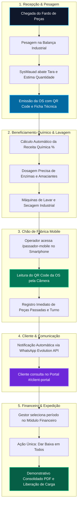

# 🚀 SysMauad • Protótipo da Solução e Apresentação do Projeto

Este documento apresenta a entrega técnica e executiva do **SysMauad**, contendo a descrição estruturada do projeto (problema, solução e público-alvo), a demonstração visual e interativa de todas as telas e do fluxo de utilização do protótipo, além das instruções completas do vídeo de apresentação desenvolvido com **Remotion** (Claude Remotion Skill) e narração via **ElevenLabs**.

---

## 📋 1. Descrição do Projeto

### ⚠️ O Problema Identificado
As lavanderias industriais especializadas em beneficiamento de jeanswear e confecções têxteis operam com alto volume de peças e processos físico-químicos intensivos, enfrentando 4 gargalos operacionais crônicos:

1. **Gargalo no Recebimento e Contagem**: Centenas de calças, jaquetas e shorts chegam ensacados. A contagem manual peça a peça é lenta, sujeita a extravios e gera divergências imediatas entre a lavanderia e a confecção.
2. **Desperdício e Erros na Dosagem Química**: Insumos nobres como enzimas celulásicas (`PVZYME`), desengomantes (`PVWET`) e amaciantes concentrados (`PVSOFT`) costumam ser aplicados no "olhômetro". A dosagem sem rigor estequiométrico eleva os custos operacionais em até 30% e gera despadronização nas tonalidades do lote.
3. **Chão de Fábrica Analógico na Passadoria**: A passadoria final das peças frequentemente depende de anotações manuais em papel ou pranchetas, impossibilitando apurar o rendimento real por operador ou diferenciar turnos de produção.
4. **Fricção Comercial e Falta de Visibilidade do Cliente**: Confecções ligam e enviam mensagens constantemente perguntando *"meu lote está pronto?"*. No fechamento quinzenal/mensal, conciliar dezenas de faturas avulsas gera atrasos e retrabalho financeiro.

---

### 💡 A Solução Proposta: SysMauad
O **SysMauad** é um ERP industrial completo e verticalizado, projetado sob medida para o polo têxtil. A solução integra e digitaliza todas as fases do negócio:

- **Pesagem Industrial Inteligente**: Abertura de ordens com leitura de peso bruto na balança, dedução automática da tara de caixas e cálculo estequiométrico da quantidade estimada de peças pela gramatura média unitária.
- **Dosagem Química Baseada no Peso Real do Lote**: Cálculo dinâmico das receitas químicas:
  $$\text{Dose do Insumo} = \text{Peso Líquido do Lote (kg)} \times \left(\frac{\% \text{ da Receita}}{100}\right)$$
- **Terminal Mobile de Passadoria com QR Code (`/passador-mobile`)**: Interface mobile de alta velocidade para chão de fábrica, permitindo que operadores bipem as etiquetas das OS na câmera do celular em menos de 1 segundo, com contagem automática e divisão de turnos.
- **Portal de Autoatendimento do Cliente (`#/client-portal`)**: Painel exclusivo para confecções consultarem suas ordens em tempo real, visualizarem peças prontas e baixarem faturas em PDF sem precisar acionar a equipe de atendimento.
- **Financeiro Consolidado com Baixa em 1 Clique**: Baixa unificada em lote ("Dar baixa em todos") para faturamentos periódicos de clientes, gerando demonstrativos consolidados sem itens redundantes e com impressão A4 limpa.
- **Automação via WhatsApp & Auditoria em Tempo Real**: Notificações automáticas para clientes via Evolution API e trilha de auditoria completa para conformidade e segurança.

---

### 🎯 Público-Alvo
1. **Gestores e Diretores de Lavanderias Industriais**: Tomadores de decisão que buscam controle de custos, rentabilidade por lote, controle de estoque químico e faturamento ágil.
2. **Equipe de Chão de Fábrica**: Operadores de máquinas de lavar, coloristas, encarregados de pesagem e passadores que necessitam de interfaces ágeis, botões grandes e leitura por QR Code sem digitação.
3. **Marcas e Confecções Parceiras (Clientes B2B)**: Estilistas, gerentes de produção e compradores que terceirizam o beneficiamento de suas coleções e exigem rastreabilidade em tempo real e faturas claras.

---

## 🔄 2. Fluxo de Utilização do Projeto (End-to-End)

O diagrama abaixo ilustra o ciclo operacional completo dentro do SysMauad:



---

## 🖥️ 3. Demonstração Visual das Principais Telas

O protótipo do SysMauad foi projetado com base no princípio de **UX limpa, sem redundâncias e de alta produtividade**. Abaixo está o detalhamento visual de cada módulo:

### 📊 Tela 1: Painel Geral (Dashboard Operacional)
- **Objetivo**: Fornecer aos gestores a temperatura imediata da fábrica em um único olhar.
- **Elementos Visuais**:
  - Cards de KPIs no topo: Peças em Processamento, Ordens Ativas, Faturamento do Dia e Eficiência da Passadoria.
  - Alerta dinâmico de insumos químicos com estoque abaixo da margem de segurança.
  - Gráfico de pizza com distribuição de status das ordens e atalho para leitura de QR Code.

```
+-----------------------------------------------------------------------------------------+
| SysMauad • Painel Operacional                              [Turno Normal]  [Admin Mauad] |
+-----------------------------------------------------------------------------------------+
| [📦 24 OS Ativas]     [👕 4.250 Peças Hoje]    [🧪 2 Químicos Críticos]  [💰 R$ 38.450]   |
+-----------------------------------------------------------------------------------------+
|  ORDENS EM ANDAMENTO (TEMPO REAL)               |  ESTOQUE DE INSUMOS CRÍTICOS          |
|  --------------------------------------------- |  ------------------------------------ |
|  OS #1042 - Destaque Têxtil | 850 Calças  | 85%|  PVZYME (Enzima)   | 18 kg (Mín: 50 kg)  |
|  OS #1043 - Roupas do Sul    | 420 Jaquetas| 30%|  PVSOFT (Amaciante)| 32 kg (Mín: 60 kg)  |
|  OS #1044 - Bella Jeans      | 1.100 Shorts| 10%|  [+ Cadastrar Entrada de Insumos]     |
+-----------------------------------------------------------------------------------------+
```

---

### ⚖️ Tela 2: Abertura de Ordem de Serviço & Pesagem Industrial
- **Objetivo**: Entrada rápida de lotes com precisão cirúrgica sem contagem manual unitária.
- **Elementos Visuais**:
  - Seleção do cliente e tipo de modelo (Calça Jeans, Jaqueta, Shorts, etc.).
  - Campos de entrada: **Peso Bruto na Balança (kg)**, **Tara das Caixas (kg)** e **Gramatura de Referência da Peça (g)**.
  - Cálculo instantâneo do **Peso Líquido** e da **Quantidade Estimada de Peças**.
  - Seleção da Receita de Lavado (ex: Hiper Destroyed, Estonado Mineral).

```
+-----------------------------------------------------------------------------------------+
| Nova Ordem de Serviço (OS)                                                              |
+-----------------------------------------------------------------------------------------+
| Cliente: [ Confecções Destaque Têxtil        ▼ ]   Modelo: [ Calça Jeans Adulto     ▼ ] |
|                                                                                         |
| [ BALANÇA INDUSTRIAL ]                                                                  |
| Peso Bruto: [ 452.00 ] kg   Tara Caixas: [ 24.00 ] kg   Ref. Peça: [ 600 ] g            |
|                                                                                         |
| ======================================================================================= |
| ⚡ RESULTADO AUTOMÁTICO:  PESO LÍQUIDO: 428,00 kg   |   ESTIMATIVA: 713 PEÇAS           |
| ======================================================================================= |
|                                                                                         |
| Processo de Lavagem: [ Estonado no Pó + Amaciado Especial ▼ ]                           |
| Preço Unitário: R$ 6,50/peça                    Total Estimado do Lote: R$ 4.634,50      |
|                                                                                         |
| [ Cancelar ]                                           [ 🖨️ Salvar e Imprimir Etiqueta ] |
+-----------------------------------------------------------------------------------------+
```

---

### 🧪 Tela 3: Receitas Químicas com Dosagem Estequiométrica (%)
- **Objetivo**: Controlar as fases químicas da máquina de lavar calculando automaticamente a quantidade exata de cada produto químico de acordo com os kg do lote.
- **Elementos Visuais**:
  - Fases sequenciais de lavagem (Desengomagem, Estonagem, Neutralização, Amaciamento).
  - Tabela com percentual aplicado por produto (ex: `0.3% PVZYME`, `1.2% PVSOFT`).
  - Geração da folha de processo para colar no tambor de lavagem.

---

### 📱 Tela 4: Terminal Passador Mobile (`/passador-mobile`)
- **Objetivo**: Usabilidade máxima no chão de fábrica em celulares e tablets com leitura de QR Code.
- **Elementos Visuais**:
  - Botão grande de acionamento da câmera para bipar o QR Code da OS.
  - Exibição em letras garrafais da OS lida, modelo da peça e quantidade já passada.
  - Registro com 1 toque por turno (Normal ou Adicional/Extra).
  - Feedback visual sonoro imediato de sucesso.

```
+------------------------------------+
|  MAUAD • TERMINAL DA PASSADORIA    |
|  Operador: Carlos Silva (Turno 1)  |
+------------------------------------+
|                                    |
|      [ 📷 LER QR CODE DA OS ]      |
|                                    |
|  OS BIPADA: #1042                  |
|  Cliente: Destaque Têxtil          |
|  Modelo: Calça Skinny Destroyed    |
|  Meta do Lote: 713 peças           |
|                                    |
|  [ + 50 Peças ]    [ + 100 Peças ] |
|                                    |
|  Total Passado Hoje: 620 peças     |
+------------------------------------+
```

---

### 🌐 Tela 5: Portal do Cliente (`#/client-portal`)
- **Objetivo**: Autoatendimento para confecções parceiras acompanharem seus pedidos 24/7.
- **Elementos Visuais**:
  - Login seguro via telefone e senha do cliente sem poluição visual.
  - Tabela de ordens com badges de status claros: `Em Lavagem`, `Em Passadoria`, `Pronto p/ Retirada`.
  - Botões para visualizar ficha do lote e baixar demonstrativo financeiro em PDF.

---

### 💰 Tela 6: Módulo Financeiro & Caixa Consolidado
- **Objetivo**: Eliminar itens redundantes e permitir liquidação de múltiplas ordens em 1 clique.
- **Elementos Visuais**:
  - Filtro unificado por período e cliente.
  - Botão de ação direta: **"Dar baixa em todos"**.
  - Modal consolidado com valor bruto, descontos e valor líquido recebido.
  - Emissão de fatura limpa formatada para folha A4 com `@page { margin: 0; }` (sem cabeçalhos e rodapés de navegador).

---

## 🎬 4. Vídeo de Apresentação com Remotion

O projeto do vídeo de apresentação foi inteiramente programado dentro da pasta `remotion-presentation/`, utilizando o framework **Remotion** em React 18 e TypeScript, de acordo com as especificações do **Claude Remotion Skill**:

### 🎞️ Ficha Técnica do Vídeo
- **Duração**: 60 Segundos (1800 frames a 30 FPS)
- **Resolução**: 1920x1080 (Full HD, proporção 16:9)
- **Física de Movimento**: Funções `spring()` com damping harmônico e desaceleração natural.
- **Design System**: Paleta Dark Industrial (Deep Navy, Sky Blue, Emerald Green, Amber, Rose).

### 📑 Estrutura das Cenas e Roteiro de Narração

| Cena | Frame / Tempo | Tema Visual | Resumo da Narração |
|------|---------------|-------------|-------------------|
| **Cena 1** | 0 a 270 (0s - 9s) | Logo SysMauad animado, brilhos radiais e badges | *"No universo dinâmico da indústria têxtil e do jeanswear, a eficiência define o lucro. Conheça o SysMauad..."* |
| **Cena 2** | 270 a 540 (9s - 18s) | 4 Cards dos gargalos da indústria têxtil | *"Por anos, lavanderias sofreram com contagens manuais imprecisas, químicos no olhômetro e chão de fábrica sem rastreio..."* |
| **Cena 3** | 540 a 810 (18s - 27s) | Visão do ERP e Mockup animado do Dashboard | *"O SysMauad transforma esse cenário com uma plataforma em tempo real que conecta do recebimento à entrega..."* |
| **Cena 4** | 810 a 1260 (27s - 42s) | Telas interativas: Pesagem com tara, Químicos %, QR Mobile e Baixa | *"Pesagem inteligente abatendo a tara das caixas, dosagem química percentual sobre os quilos do lote e leitura via QR Code..."* |
| **Cena 5** | 1260 a 1530 (42s - 51s) | Portal do Cliente e Notificações WhatsApp | *"Para as confecções parceiras: portal 24 horas para consultar lotes e avisos automáticos no WhatsApp..."* |
| **Cena 6** | 1530 a 1800 (51s - 60s) | Contadores animados: +40% velocidade, -25% custos | *"+40% em produtividade e controle absoluto. SysMauad: a tecnologia que move a lavanderia industrial do futuro."* |

---

## 🎙️ 5. Narração Profissional com ElevenLabs & MCP

O projeto conta com integração completa para geração de voz profissional via **ElevenLabs**:

### Como Gerar o Áudio da Narração:
1. Obtenha sua API Key em [elevenlabs.io](https://elevenlabs.io).
2. Configure a variável de ambiente:
   ```bash
   export ELEVENLABS_API_KEY="sua_chave_aqui"
   ```
3. Execute o script automatizado:
   ```bash
   node remotion-presentation/elevenlabs/generate_voiceover.js
   ```
   O áudio narrado em português com alta fidelidade será salvo diretamente em `remotion-presentation/public/audio/narracao.mp3`.

### Integração via MCP (Model Context Protocol):
O arquivo `remotion-presentation/elevenlabs/elevenlabs_mcp_guide.md` detalha como adicionar o servidor MCP no seu cliente (Claude Code, Claude Desktop ou Cursor), permitindo invocar a síntese de voz diretamente através de prompts como:
> *"ElevenLabs, gere a narração em português a partir do arquivo script_narracao.md usando a voz Daniel."*

---

## 🛠️ 6. Como Executar e Testar Tudo

### Testar o Protótipo do Sistema em Funcionamento:
O sistema completo já está operacional nos contêineres Docker do ambiente:
1. **Frontend / Sistema Principal**: Acesse `http://localhost/` ou a URL do servidor.
2. **Terminal Mobile da Passadoria**: Acesse `http://localhost/#/passador-mobile`.
3. **Portal do Cliente**: Acesse `http://localhost/#/client-portal`.
4. **Credenciais de Teste**:
   - Administrador: `admin` / `admin123`
   - Passador de Chão de Fábrica: `carlos` / `passador123`
   - Cliente Confecção: Telefone cadastrado no portal.

### Visualizar ou Renderizar o Vídeo Remotion:
1. Acesse o diretório do vídeo:
   ```bash
   cd remotion-presentation
   npm install
   ```
2. Para abrir o **Remotion Studio** no navegador com timeline interativa e preview em tempo real:
   ```bash
   npm start
   ```
3. Para renderizar o vídeo final em arquivo `.mp4` Full HD:
   ```bash
   npm run build
   ```
   O arquivo final será gerado em `remotion-presentation/out/sysmauad-apresentacao.mp4`.
